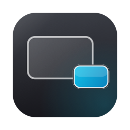

<div align="center">



# Glance

**Picture-in-picture for any window on your Mac.**

A small, fully native macOS menu bar app. Drag over anything on screen and pin it<br>
to a floating, always-on-top panel. No browser, no extension, no Electron.

[](#requirements)
[](https://swift.org)
[](project.yml)
[](LICENSE)

</div>

---

## Features

- **Pin any region.** Drag a rectangle over a video, a build log, a chart or a video call, on any display and in any app. Glance pins it to a small panel that stays above every other window and follows you across Spaces.
- **Follows the window, not the screen.** While you drag, Glance highlights the window that owns more than half of the selection and anchors the crop to it. Move Safari to the other side of the display and the panel keeps showing the same part of Safari. If no window owns the majority, Glance captures the display instead and shows no highlight.
- **Ghost Mode.** Dims the panel to 55 % and lets every click pass through to the app behind it.
- **Corner snapping.** Release the panel near a corner and it springs into place (`response 0.3`, `damping 0.6`, solved analytically). Release it anywhere else and it stays put.
- **Aspect-locked resize.** Drag any corner and the panel keeps the capture's exact ratio, so the content always fills it.
- **Zero-copy rendering.** Frames go straight from the WindowServer's `IOSurface` to a `CALayer`, with no texture upload, colour conversion or CPU copy.
- **Menu bar only.** Glance never shows a Dock icon.

## Usage

| Action | How |
|---|---|
| New capture | `⌥⇧G` (customizable) |
| Toggle Ghost Mode | `⌥G` (customizable) |
| Leave Ghost Mode | `⌥G`, the exit badge in the panel's corner, or the menu bar item |
| Move the panel | Drag it. Release near a corner to snap. |
| Resize the panel | Drag any corner |
| Change shortcuts | **Settings → Shortcuts & Onboarding…** |

In Ghost Mode the panel ignores the mouse, so the shortcut is the guaranteed way out. The corner exit badge is the one part of the panel that stays clickable.

## Install

Glance is built with [XcodeGen](https://github.com/yonaskolb/XcodeGen) from `project.yml`.

```bash
brew install xcodegen
git clone https://github.com/filippocappa/glance.git
cd glance
./build_and_run.sh          # generate, build, verify signature, launch
./build_and_run.sh --logs   # ...and stream the app's OSLog output
```

The script builds a Release bundle into `Build/`, verifies its code signature and launches `Glance.app`.

> [!IMPORTANT]
> On first launch, macOS asks for **Screen Recording** permission. Grant it in **System Settings → Privacy & Security → Screen & System Audio Recording**.

> [!TIP]
> Sign Glance with a **stable** identity: set `CODE_SIGN_IDENTITY` in `project.yml` to your own development certificate. macOS ties the Screen Recording grant to the app's signature. An ad-hoc signature has no team identifier, so the grant gets pinned to the binary's hash, which changes on every build and silently revokes the permission each time. For the same reason, `build_and_run.sh` never re-signs the bundle after Xcode has.

### Requirements

- macOS 14 Sonoma or later
- Xcode 15+ and XcodeGen to build

## How it works

```
SelectionOverlayView ──▶ SelectionCoordinator ──▶ GlanceCoordinator
   (drag a rect)            (one overlay/screen)     (owns all state)
                                                            │
                                                            ▼
                                                     CaptureEngine
                                                            │
                              SCContentFilter(desktopIndependentWindow:)
                                   ── or, for desktop selections ──
                              SCContentFilter(display:excludingWindows:)
                                                            │
                                              IOSurface (zero-copy, XPC)
                                                            ▼
                                    VideoLayerView  →  layer.contents
                                                            ▼
                                                       GlancePanel
                                              (borderless floating NSPanel)
```

1. **Select.** One overlay per screen lets you drag a rectangle, screenshot-style, and reports which window owns it.
2. **Capture.** `CaptureEngine` starts an `SCStream` filtered to that window (or to the display, for desktop selections) and crops it to your region.
3. **Render.** Each frame's `IOSurface` is handed straight to the panel's layer, with no copy.

### Coordinate spaces

There are three, and mixing them up causes most capture bugs:

- **Cocoa global.** Bottom-left origin, relative to the primary display. Used by `NSScreen` and `NSWindow`, and by the selection overlay.
- **Core Graphics global.** Top-left origin. Used by `SCWindow.frame` and `CGWindowListCopyWindowInfo`.
- **Filter content rect.** What `SCStreamConfiguration.sourceRect` is measured against. For a window filter this is *not* the window's global frame.

`sourceRect` is in **points**. `config.width` and `config.height` are in **backing pixels** (points × `filter.pointPixelScale`). `destinationRect` is in output-surface pixels and is intentionally left unset.

### Debugging

```bash
log stream --style compact --level debug \
  --predicate 'subsystem == "com.filippocappa.glance"'
```

Channels: `permissions`, `capture`, `render`, `window`, `selection`. Uncaught exceptions are logged to the `window` channel with a stack trace, because AppKit swallows some resize-time exceptions without writing a crash report.

## Project structure

| File | Responsibility |
|---|---|
| `GlanceApp.swift` | Entry point and `GlanceCoordinator`, which owns all state |
| `Capture/CaptureEngine.swift` | `SCStream` lifecycle, target resolution, coordinate conversion, frame delivery |
| `Capture/ScreenPicker.swift` | `NSScreen` ↔ `SCDisplay` bridging and window hit-testing |
| `PiP/GlanceWindowController.swift` | The floating panel: drag, snap, resize, Ghost Mode |
| `PiP/VideoLayerView.swift` | `IOSurface` → `CALayer` presentation |
| `Selection/` | The screenshot-style region picker |
| `Onboarding/` | First-run splash: permission, launch at login, shortcuts |
| `Utilities/SnapEngine.swift` | Corner anchors and the analytical spring solver |
| `Utilities/Log.swift` | OSLog channels and uncaught-exception diagnostics |

Scripts:

- `build_and_run.sh` generates the project, builds, verifies the signature and launches the app.
- `Tools/make-icon.swift` renders every icon size plus `Tools/Glance.icns` with Core Graphics. Run it with `swift Tools/make-icon.swift`.

## Dependencies

- [KeyboardShortcuts](https://github.com/sindresorhus/KeyboardShortcuts) for global hotkeys and the recorder UI
- [LaunchAtLogin-Modern](https://github.com/sindresorhus/LaunchAtLogin-Modern) for the login item

Everything else is Apple frameworks: AppKit, SwiftUI and ScreenCaptureKit.

## License

[MIT](LICENSE) © 2026 Filippo Cappa
